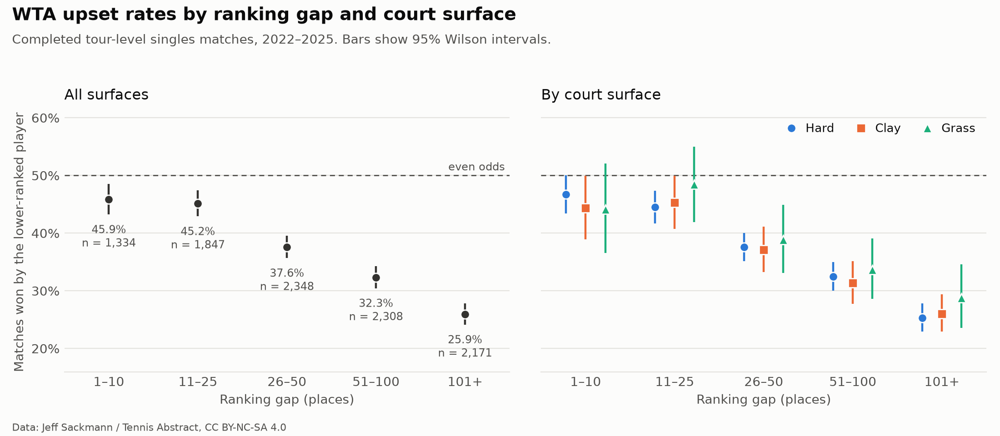

# When the world No. 1 loses

At the 2025 Berlin semifinal, world No. 164 Markéta Vondroušová beat No. 1 Aryna Sabalenka 6–2, 6–4. A 163-place gap sounds extraordinary, yet Vondroušová had already won Wimbledon. How often does the lower-ranked player win, and how much does the distance between two rankings tell us? [WTA match report](https://www.wtatennis.com/news/4293012/vondrousova-ousts-sabalenka-in-berlin-earns-first-win-over-a-world-no-1)

**The lower-ranked player won 3,638 of 10,008 completed WTA singles matches (36.4%)** in the 2022–2025 sample. The rate fell from **45.9%** for players 1–10 places apart (612 of 1,334 matches) to **25.9%** for players at least 101 places apart (563 of 2,171). An upset means the player with the larger pre-match ranking number won. [Counts and intervals for every group](reports/rates.csv)



## Does the surface matter?

With a ranking gap of 101 or more, the grass estimate was highest, but grass also had the fewest matches. Its interval runs from 23.5% to 34.6%. Different player fields and tournament schedules make it difficult to isolate the effect of a surface.

| Surface | Upsets / matches | Upset rate | 95% Wilson interval |
| --- | ---: | ---: | ---: |
| Hard | 304 / 1,202 | 25.3% | 22.9%–27.8% |
| Clay | 186 / 715 | 26.0% | 22.9%–29.4% |
| Grass | 73 / 254 | 28.7% | 23.5%–34.6% |

These pointwise intervals treat matches as independent. Players recur across events, so the intervals can understate uncertainty. A formal comparison of surfaces would need to account for those repeated appearances and differences in who played each event.

## Can rankings predict upsets in a later season?

No. 5 versus No. 15 and No. 105 versus No. 115 both have a ten-place gap. Their rank ratios are 3.0 and about 1.1, respectively. The benchmark fits a logistic model with one feature, the log of the larger rank number divided by the smaller. Swapping winner and loser leaves that feature unchanged, so it can be calculated before a match. The intercept is fixed at zero, giving even odds as the two ranks converge. A fixed ridge penalty regularizes the fitted slope.

Both models trained on **7,565 matches from 2022–2024** and were evaluated on **2,443 matches from 2025**. This is a retrospective evaluation: the descriptive study above already included 2025, so that season was held out of the model fit but was not unseen when the analysis was designed. The baseline gave each match the same probability, the training upset rate. The rank-ratio model improved both probability scores on this single held-out season. Lower scores are better. [Model results and fitted coefficient](reports/benchmark.csv)

| Probability estimate | Brier score | Log loss |
| --- | ---: | ---: |
| Training upset rate | 0.234354 | 0.661543 |
| Rank-ratio logistic model | **0.221253** | **0.632290** |

The fitted probabilities use rankings alone. Vondroušová’s grass-court record and recent injury are examples of information the model cannot see.

## Reproduce the analysis

From the repository root with Python 3.12 installed, run the following in a macOS or Linux shell. On Windows PowerShell, activate the environment with `.\.venv\Scripts\Activate.ps1`.

```sh
python -m venv .venv
source .venv/bin/activate
python -m pip install -r requirements.txt
python -m wta_upsets
python -m unittest discover -s tests -v
```

The default run reads the four bundled season files and writes the figure and CSV tables to `reports/`. To analyze a different pair of seasons while preserving the published results, use a separate output folder.

```sh
python -m wta_upsets --seasons 2023 2024 --output build/short
```

The benchmark is fitted on the earlier selected seasons and scored retrospectively on the latest. With a single season the run still writes the rates, exclusions and figure, omits the benchmark and removes any `benchmark.csv` already in that output folder.

The notebook walks through match selection, group estimates and the held-out benchmark using the same Python modules as the command line. [Open the analysis notebook](notebooks/wta-upsets.ipynb)

## Match selection and data credit

The source files contain 10,888 rows. The filters exclude 246 lower-tier matches, 93 rows with missing or unsupported surfaces, 135 with unusable rankings and 406 with an unfinished or missing score. Each excluded row counts once, at its first failed check. The analysis also checks dates and equal ranks. Season labels come from the source file because an event can begin in the preceding December. [Exclusion counts by season](reports/exclusions.csv)

Jeff Sackmann / Tennis Abstract compiled the match data. The bundled CSVs are unchanged copies from a pinned archive revision. The data, derived tables and chart use CC BY-NC-SA 4.0. [Original data author](https://github.com/JeffSackmann) · [Source archive](https://github.com/Aneeshers/tennis-sackmann-archive/tree/83733587353df8a41f2fd4f516147d5aa83f5a8d) · [File provenance and checksums](data/provenance.json) · [Data license](data/LICENSE)

The original project examined upset frequencies by ranking gap and surface. The command-line workflow, regression tests and held-out benchmark were developed with AI assistance for this public edition.
